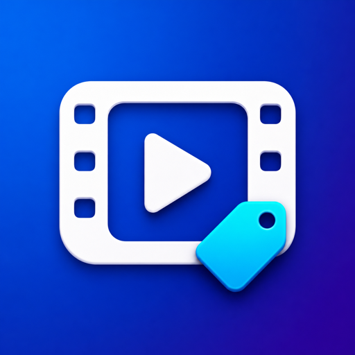

# FileFacet — Local-first Video Tagging for macOS

<p align="center">
  
</p>

English | [简体中文](README.zh-CN.md)

FileFacet is a native, local-first macOS video tag manager for organizing videos across multiple folders with hierarchical tags. Your original files stay in place and remain read-only.

[Download the latest release](https://github.com/larryisthere/FileFacet/releases/latest) · [Browse all releases](https://github.com/larryisthere/FileFacet/releases)

> The current release uses a Simplified Chinese interface. English localization is planned.

## Who FileFacet is for

FileFacet is designed for people who keep videos locally and want a flexible way to organize them without changing their folder structure:

- Creators managing footage across projects and storage locations
- People organizing personal or private video collections
- Anyone who needs tags for people, sources, purposes, status, or other overlapping categories
- Mac users who want an app-specific hierarchy beyond Finder's flat tags

## Why FileFacet

- **One library across folders** — import individual videos, multiple folders, or a mixture of both into one searchable library.
- **Hierarchical video tags** — build multi-level tag trees, batch-edit assignments, merge tags, add colors, and organize tags with drag and drop.
- **Files stay where they are** — FileFacet reads original videos without moving, renaming, modifying, or deleting them.
- **Local-first and private** — the library index, tags, access permissions, and thumbnails stay on your Mac. FileFacet makes no network requests by default.
- **Native macOS workflow** — use Quick Look, open videos in your default player, reveal files in Finder, and protect the library with optional system authentication.

If FileFacet fits your workflow, [star the repository](https://github.com/larryisthere/FileFacet) to support its development and find it again.

## How it works

1. Choose **File > Import Videos and Folders…** or drag videos and folders into FileFacet.
2. FileFacet recursively discovers supported videos and adds them to a unified library.
3. Existing Finder tags are imported once when a video first enters the library.
4. Create hierarchical tags, apply them to one or many videos, and filter the library by tag or filename.
5. Preview with Quick Look, open a video in your default player, or reveal it in Finder.

Repeated imports are safe: the same file keeps a single library record, including when parent folders, child folders, and individual videos overlap.

## Features

### Organize

- Multi-level tags with custom order, name sorting, and video-count sorting
- Single- and multi-video tagging with selected, unselected, and mixed states
- Drag videos onto tags or tags onto videos
- Tag creation, renaming, reparenting, merging, colors, and single-step undo
- One-time Finder tag import into independent FileFacet tags

### Find and browse

- Filename search
- Recursive parent-tag filtering
- Multi-tag AND filtering
- Untagged and recently added collections
- Video thumbnails, duration, dimensions, and file information
- Quick Look, default-player playback, Finder reveal, and path copying

### Protect your library

- Optional app lock using macOS system authentication
- Privacy shield when the library is locked
- Configurable idle locking
- Local storage for the index, tags, bookmarks, and thumbnails
- Read-only access to original videos

### Keep locations current

- Stable file identity prevents duplicate records across imported sources
- Background maintenance follows supported moves and renames
- Missing and deleted files are reconciled without changing the originals

## Download and install

### Requirements

- macOS 14 Sonoma or later
- Apple silicon or Intel Mac
- Simplified Chinese interface in the current release

### Installation

1. Open the [latest GitHub Release](https://github.com/larryisthere/FileFacet/releases/latest).
2. Download the `FileFacet-<version>-<build>-macOS-universal.zip` asset.
3. Unzip it and move `FileFacet.app` to your Applications folder.
4. Open FileFacet and import the videos or folders you want to organize.

Public release builds are Universal Apps signed with Developer ID and notarized by Apple. Each release also includes a SHA-256 checksum.

## Supported video formats

- MP4
- MOV
- M4V
- MKV
- AVI
- WebM

Media playback and preview availability can depend on the codecs supported by the installed macOS version and the user's selected apps.

## Privacy and file safety

- FileFacet makes no network requests by default.
- Tags, the file index, access permissions, and thumbnails are stored locally.
- Logs exclude full file paths, filenames, tag contents, and bookmark data.
- Original videos are opened with read-only access.
- Removing a video from the FileFacet library leaves the original file untouched.

The optional app lock protects access to FileFacet. It does not encrypt the original video files.

## Frequently asked questions

### Does FileFacet move or modify my videos?

No. FileFacet indexes videos in their existing locations and keeps read-only access to the originals.

### Does FileFacet write to Finder tags?

No. Finder tags are read once when a video first enters the library. Imported tags then become independent FileFacet tags, so later edits in either system do not change the other.

### Can I import from multiple folders?

Yes. Videos, folders, and mixed selections share one library, tag tree, search scope, and filtering space.

### Does FileFacet upload library data?

No. FileFacet makes no network requests by default, and library data stays on the Mac.

### What happens when a video moves?

FileFacet uses file identity and authorized source locations to maintain the library record when supported moves or renames are detected.

## Build from source

Building FileFacet requires Xcode 16 or a compatible newer version.

```bash
xcodebuild \
  -project VideoTagManager.xcodeproj \
  -scheme VideoTagManager \
  -configuration Debug \
  -derivedDataPath .build/DerivedData \
  CODE_SIGNING_ALLOWED=NO \
  build
```

The local development script is `./script/build_and_run.sh`. It builds, signs, and launches the app, so configure your development signing in Xcode before using it.

Ruby and Bundler are only required for the Fastlane release workflow documented in [docs/release.md](docs/release.md).

## Project structure

- `App/` — application lifecycle and window coordination
- `Core/` — database, file access, scanning, media, and security services
- `Features/` — library, settings, and app-lock interfaces
- `Tests/` — automated checks for core models and services
- `docs/product/` — current requirements and acceptance records
- `docs/architecture/` — accepted architecture decisions
- `docs/release.md` — local, GitHub, and App Store release workflows

Automated checks validate only their stated assertions. Product logic, interaction, and UI remain subject to user acceptance.

## Contributing and security

Contributions are welcome. See [CONTRIBUTING.md](CONTRIBUTING.md) before opening a pull request.

Report vulnerabilities privately by following [SECURITY.md](SECURITY.md).

## License

FileFacet is available under the [MIT License](LICENSE).
