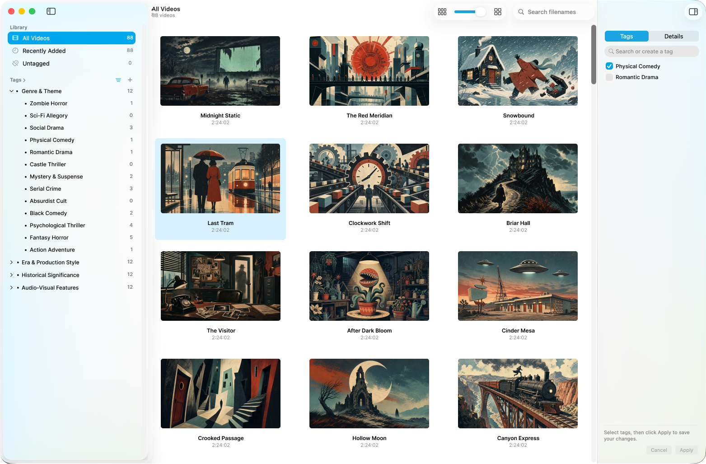

# Tagivy — macOS 本地优先视频标签管理器

> Tagivy 使用新的 macOS 应用标识，不会自动导入 FileFacet 的图库、设置、缩略图或文件夹权限。如仍需旧图库，请保留 FileFacet 及其数据。

<p align="center">
  
</p>

[English](README.md) | 简体中文

Tagivy 是一款原生、以本地数据为基础的 macOS 视频标签管理器，可通过层级标签统一整理多个文件夹中的视频。所有原始文件均保留在原位置，并始终以只读方式访问。

[下载最新版本](https://github.com/larryisthere/FileFacet/releases/latest) · [查看版本历史](CHANGELOG.md)

> Tagivy 支持英文和简体中文，并跟随 macOS 中为该 App 设置的语言。

<p align="center">
  
</p>

## Tagivy 适合谁

Tagivy 面向在本地保存视频，并希望灵活整理视频且保持现有文件夹结构的用户：

- 管理多个项目和存储位置中视频素材的创作者
- 整理个人或私密视频收藏的用户
- 需要按人物、来源、用途、状态等多个维度分类的用户
- 希望在 Finder 平铺标签之外建立应用内层级标签体系的 Mac 用户

## 为什么选择 Tagivy

- **跨文件夹统一资料库**：可以导入单个视频、多个文件夹或两者的混合内容，并在同一个资料库中搜索和筛选。
- **目录结构生成标签**：导入文件夹时可以将其中的目录转换为层级标签，并可选择是否将每个所选文件夹本身作为根标签。
- **主动扫描新视频**：检查此前选择的文件夹中尚未进入 Tagivy 的视频，预览扫描结果，并选择部分或全部导入。
- **外置资料库离线可用**：外置磁盘断开后，已经索引的视频仍可浏览、搜索和整理标签；磁盘重新连接后会自动恢复原文件访问。
- **层级视频标签**：支持多层级标签树、批量编辑、标签合并、颜色和拖拽整理。
- **智能筛选与智能分类**：组合标签、文件名、日期、媒体属性和排序，并将常用组合保存为实时更新的智能分类。
- **原始文件保留在原位置**：Tagivy 只读取视频，不会移动、重命名、修改或删除原始文件。
- **本地优先与隐私保护**：资料库索引、标签、访问授权和缩略图均保存在 Mac 本机；Tagivy 默认不发起网络请求。
- **原生 macOS 工作流**：支持 Quick Look、默认播放器、Finder 定位，以及可选的系统身份验证保护。

如果 Tagivy 适合你的视频整理方式，可以为[仓库添加 Star](https://github.com/larryisthere/FileFacet)，支持后续开发并方便再次找到它。

## 使用方式

1. 选择“文件 > 导入视频与文件夹…”，或将视频和文件夹拖入 Tagivy。
2. 导入文件夹时，可以选择直接导入，或根据目录结构创建层级标签；Tagivy 可以记住这个偏好。
3. 使用工具栏或“文件 > 扫描新视频”检查这些文件夹后来新增的视频，并选择部分或全部扫描结果导入。
4. 视频首次加入资料库时，已有 Finder 标签会执行一次单向导入。
5. 创建层级标签，为一个或多个视频批量打标，再组合文件名、标签、日期、时长、文件大小或分辨率筛选。
6. 将常用组合保存为智能分类，也可以仅作为临时视图使用。
7. 使用 Quick Look 预览、默认播放器打开视频，或在 Finder 中定位文件。

重复导入会保持单条视频记录。父文件夹、子文件夹和单个视频存在重叠时，Tagivy 会自动合并重复范围。

## 功能

### 整理

- 多层级标签，以及自定义、按名称和按视频数量排序
- 导入时按文件夹结构创建层级标签
- 单个和多个视频的已选、未选与部分选中状态
- 将视频拖到标签，或将标签拖到视频
- 标签创建、重命名、调整层级、合并、颜色和单步撤销
- 将 Finder 标签首次单向导入为独立的 Tagivy 标签

### 查找与浏览

- 使用 `Command-F` 进行临时文件名搜索
- 组合文件名、标签、未打标签、日期、时长、文件大小和分辨率筛选
- 直接显示全部 / 任一条件关系，并始终限定在当前分类或标签范围内
- 按文件名、日期、时长、文件大小或分辨率排序
- 保存带实时数量的智能分类，并支持预览、还原、更新、另存为、重命名和删除
- 父标签递归筛选
- 未打标签和最近添加分类
- 主动扫描、会话级 Quick Look 候选预览、可选择结果，以及完成导入后的自动定位
- 外置磁盘断开时按需出现的“离线”分类
- 视频缩略图，以及按文件、视频编码和音频编码分组的媒体源信息
- Quick Look、默认播放器、Finder 定位和路径复制

### 保护资料库

- 使用 macOS 系统身份验证的可选应用锁
- 资料库锁定时显示隐私遮罩
- 可配置的闲置锁定
- 索引、标签、Bookmark 和缩略图保存在本机
- 原始视频保持只读访问

### 维护文件位置

- 使用稳定文件身份避免多个导入来源产生重复记录
- 后台维护已支持的视频移动和重命名
- 外置磁盘离线时继续保留缓存缩略图、媒体信息和标签
- 已授权外置磁盘重新连接后自动恢复文件访问
- 在不改变原始文件的前提下处理文件缺失和删除状态

## 下载与安装

### 使用要求

- macOS 14 Sonoma 或更高版本
- Apple 芯片或 Intel Mac

### 安装

1. 打开[最新 GitHub Release](https://github.com/larryisthere/FileFacet/releases/latest)。
2. 下载 `Tagivy-<版本>-<构建号>-macOS-universal.zip`。
3. 解压后将 `Tagivy.app` 移入“应用程序”文件夹。
4. 打开 Tagivy，并导入需要整理的视频或文件夹。

公开发布版本为 Universal App，已经过 Developer ID 签名和 Apple 公证。每个版本同时提供 SHA-256 校验文件。

## 支持的视频格式

- MP4
- MOV
- M4V
- MKV
- AVI
- WebM

媒体播放和预览能力可能受到当前 macOS 版本支持的编解码器及用户所选应用影响。AVFoundation 和 Quick Look 都无法解码画面时，Tagivy 会显示通用视频图标。

## 隐私与文件安全

- Tagivy 默认不发起网络请求。
- 标签、文件索引、访问授权和缩略图保存在本机。
- 日志不包含完整文件路径、文件名、标签内容和 Bookmark 数据。
- 原始视频始终以只读方式访问。
- 从 Tagivy 资料库移出视频时，原始文件继续保留。

可选应用锁用于保护 Tagivy 的访问入口，不负责加密原始视频文件。

## 常见问题

### Tagivy 会移动或修改我的视频吗？

不会。Tagivy 在视频现有位置建立索引，并保持对原始文件的只读访问。

### Tagivy 会写入 Finder 标签吗？

不会。视频首次加入资料库时，Tagivy 只读取一次 Finder 标签。导入完成后，两套标签独立存在，任一侧的后续修改都不会影响另一侧。

### 可以从多个文件夹导入吗？

可以。视频、文件夹和混合选择共享同一个资料库、标签树、搜索范围和筛选空间。导入文件夹时可以保持直接导入，也可以根据目录结构创建层级标签。所选文件夹自身默认不进入标签树，也可以选择将其作为根标签。

### Tagivy 会上传资料库数据吗？

不会。Tagivy 默认不发起网络请求，资料库数据保存在 Mac 本机。

### 视频移动后会怎样？

Tagivy 通过文件身份和已授权来源位置，在检测到受支持的移动或重命名后维护原有资料库记录。

### 外置磁盘断开后会怎样？

已经索引的视频会继续保留在资料库中，并显示缓存缩略图、媒体信息和 Tagivy 标签。离线视频仍可搜索和整理标签；需要原文件的操作会暂时不可用。已授权磁盘重新连接后，Tagivy 会自动恢复原文件访问。

## 从源码构建

从源码构建 Tagivy 需要 Xcode 16 或兼容的更新版本。

```bash
xcodebuild \
  -project VideoTagManager.xcodeproj \
  -scheme VideoTagManager \
  -configuration Debug \
  -derivedDataPath .build/DerivedData \
  CODE_SIGNING_ALLOWED=NO \
  build
```

本地开发脚本为 `./script/build_and_run.sh`。该脚本会构建、签名并启动应用，使用前需要在 Xcode 中配置开发签名。

Ruby 和 Bundler 仅用于 [docs/release.md](docs/release.md) 中记录的 Fastlane 发布流程。

## 项目结构

- `App/`：应用生命周期与窗口协调
- `Core/`：数据库、文件访问、扫描、媒体和安全服务
- `Features/`：资料库、设置和应用锁界面
- `Tests/`：核心模型和服务自动化检查
- `docs/product/`：当前需求与验收记录
- `docs/architecture/`：已接受的架构决策
- `docs/release.md`：本地、GitHub 和 App Store 发布流程

自动化检查只验证其中写明的断言。产品逻辑、交互和 UI 仍以用户验收结果为准。

## 贡献与安全

欢迎参与改进。提交 Pull Request 前请阅读 [CONTRIBUTING.md](CONTRIBUTING.md)。

安全问题请按照 [SECURITY.md](SECURITY.md) 通过私密渠道报告。

## License

Tagivy 使用 [MIT License](LICENSE)。
